<div align="center">

# 🥬 Evdekiler

**Buzdolabındakini bil, ne pişireceğini bul.**

Market fişini okutup buzdolabını dolduran, son kullanma tarihi yaklaşanları hatırlatan ve eldeki malzemelere göre tarif öneren bir mobil uygulama; arkasında .NET 10 mikroservisleri ve bir yönetim paneli.

[](https://github.com/guleecetin/Evdekiler/actions/workflows/ci.yml)


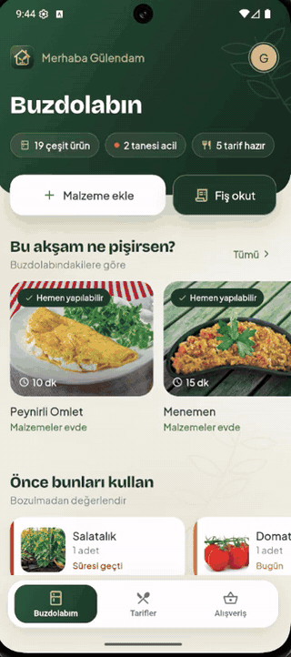

</div>

---

## İçindekiler

- [Ne yapıyor?](#ne-yapıyor)
- [Ekran görüntüleri](#ekran-görüntüleri)
- [Mimari](#mimari)
- [Teknolojiler](#teknolojiler)
- [Mühendislik kararları](#mühendislik-kararları)
- [Çalıştırma](#çalıştırma)
- [Proje yapısı](#proje-yapısı)

---

## Ne yapıyor?

|                                      |                                                                                                                                                                         |
| ------------------------------------ | ----------------------------------------------------------------------------------------------------------------------------------------------------------------------- |
| 🧾 **Fiş okutma**                    | Market fişinin fotoğrafı telefonda OCR ile okunur, satırlar sunucuda katalogdaki malzemelerle eşleştirilir. Kullanıcı onaylar, tek dokunuşla hepsi buzdolabına eklenir. |
| 🧠 **Kendi kendine öğrenen katalog** | Eşleşmeyen bir satırı kullanıcı elle bir malzemeye bağladığında bu bir _öneri_ olarak kaydedilir. Yönetici onaylayınca o yazılış bir dahaki fişte otomatik tanınır.     |
| ⏰ **Son kullanma takibi**           | Aynı malzemenin farklı tarihli partileri ayrı tutulur. Tarihi yaklaşanlar ana sayfada "önce bunları kullan" olarak öne çıkar.                                           |
| 🍳 **Tarif önerisi**                 | Tarifler buzdolabındakilere göre sıralanır: "hemen yapılabilir" ya da "2 malzeme eksik".                                                                                |
| 🛒 **Alışveriş listesi**             | Eksikler listeye eklenir. "Alındı" işaretlenen ürün, mesaj kuyruğu üzerinden buzdolabına kendiliğinden düşer.                                                           |
| 🛠️ **Yönetim paneli**                | Tarif, malzeme, fotoğraf, fiş yazılışı ve kullanıcı rollerinin yönetimi.                                                                                                |

---

## Ekran görüntüleri

### Mobil

|                           Ana sayfa                           |                         Malzeme ekleme                         |                          Fiş sonucu                           |
| :-----------------------------------------------------------: | :------------------------------------------------------------: | :-----------------------------------------------------------: |
|  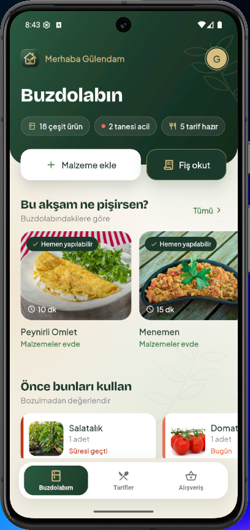   | 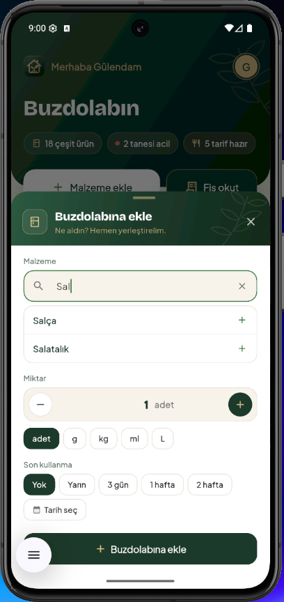 | 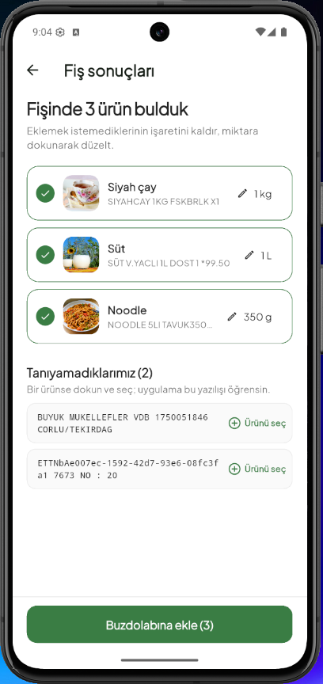 |
|                         **Tarifler**                          |                         **Alışveriş**                          |                                                               |
| 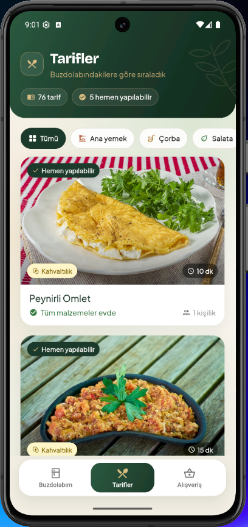 | 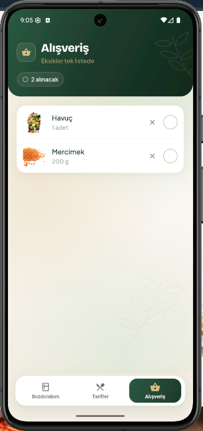 |                                                               |

### Yönetim paneli

|                             Tarifler                             |                            Malzemeler                            |
| :--------------------------------------------------------------: | :--------------------------------------------------------------: |
|   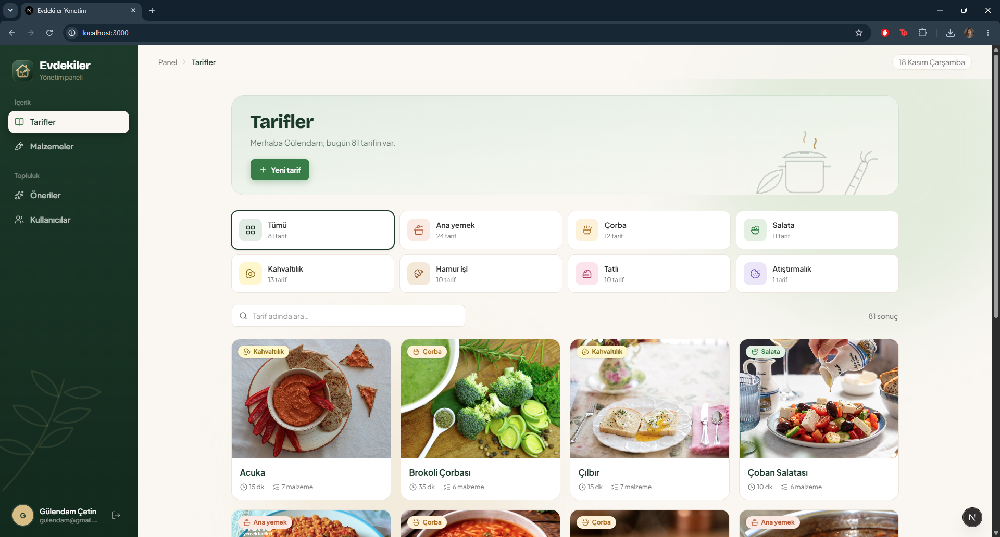   | 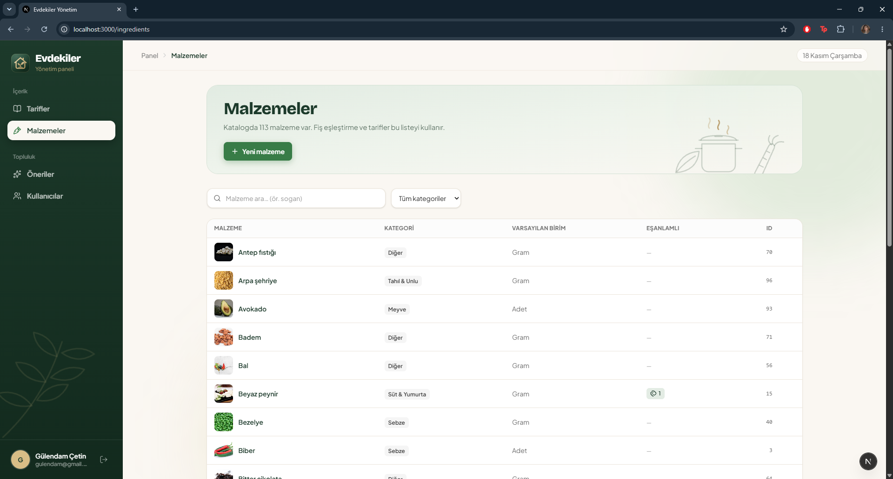 |
|                    **Fiş yazılışı önerileri**                    |                         **Kullanıcılar**                         |
| 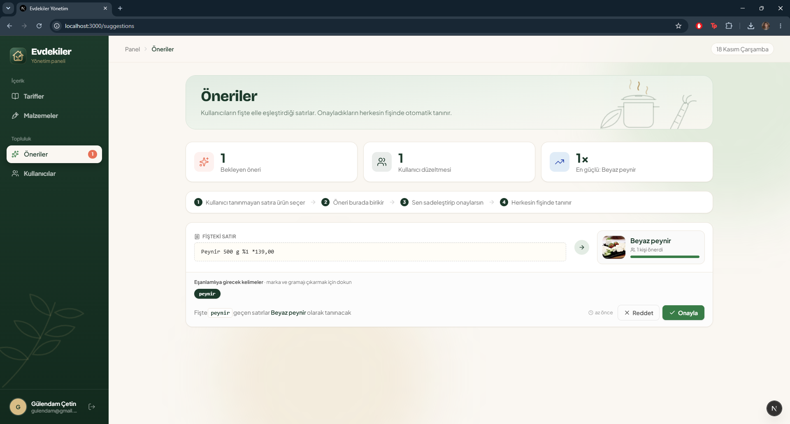 |    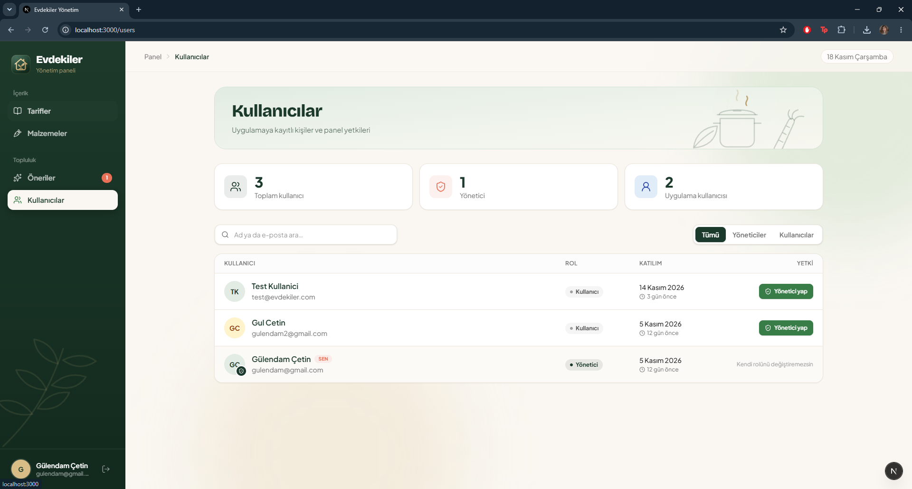    |

---

## Mimari

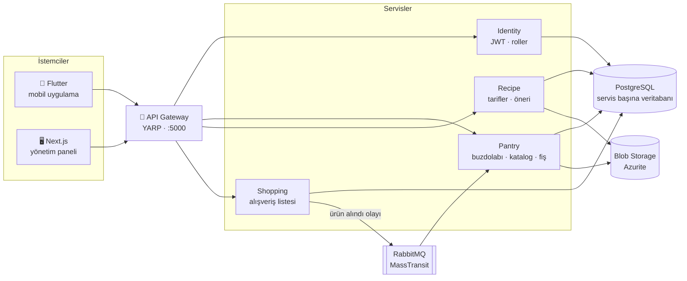

- **Tek giriş noktası:** İstemciler servisleri tanımaz, yalnızca Gateway'i bilir. Yönlendirme, CORS ve servis adresleri tek yerde.
- **Servis başına veri:** Her servis kendi veritabanına sahip. Servisler birbirinin tablosuna dokunmaz.
- **Olay tabanlı iletişim:** Alışveriş listesinde "alındı" işareti, Shopping'den Pantry'ye doğrudan HTTP çağrısıyla değil bir olayla gider. Pantry o an kapalı olsa bile mesaj kuyrukta bekler ve kaybolmaz (_eventual consistency_).

---

## Teknolojiler

| Katman      | Kullanılanlar                                                                                       |
| ----------- | --------------------------------------------------------------------------------------------------- |
| **Backend** | .NET 10 · ASP.NET Core Minimal API · EF Core 10 · Npgsql · MassTransit · YARP · JWT + refresh token |
| **Veri**    | PostgreSQL 17 (`pg_trgm` ile bulanık arama) · RabbitMQ · Azure Blob Storage (yerelde Azurite)       |
| **Mobil**   | Flutter · Riverpod · go_router · Dio · Google ML Kit (cihaz üstü OCR)                               |
| **Panel**   | Next.js · React · TypeScript · Tailwind CSS                                                         |
| **Altyapı** | Docker Compose · çok aşamalı Dockerfile · EF Core migration bundle · GitHub Actions                 |
| **Test**    | xUnit                                                                                               |

---

## Mühendislik kararları

Projenin asıl amacı, gerçek bir üründe karşılaşılan problemleri çözmekti. Önemli kararlar ve gerekçeleri:

### Fiş okuma hattı

- **OCR cihazda, anlamlandırma sunucuda.** Fotoğraf sunucuya gönderilmiyor: hem gizlilik hem bant genişliği için ML Kit metni telefonda çıkarıyor. Satırları anlamlandırmak (fiyat ve adet ayıklama, malzeme eşleştirme) sunucuda yapılıyor; böylece kurallar uygulama güncellemesi gerektirmeden değişebiliyor.
- **Saf fonksiyonlar, kolay test.** `ReceiptParser` veritabanına ya da HTTP'ye dokunmuyor, girdi metin, çıktı satır listesi. Bu sayede gerçek fiş örnekleriyle birim testi yazılabiliyor.
- **Katalog bellekte, değişince geçersiz kılınıyor.** Eşleştirici her fişte katalogu veritabanından okumuyor; `IMemoryCache`'te tutuyor. Yönetici bir malzemeyi ya da yazılışı değiştirdiğinde önbellek hemen temizleniyor.

### Eşzamanlılık ve veri bütünlüğü

- **Toplu ekleme atomik.** Fişten gelen 15 ürün tek `SaveChanges` ile ekleniyor: ya hepsi eklenir ya hiçbiri.
- **"Önce kontrol et, sonra yaz" yarışına karşı benzersiz index.** İki istek aynı anda aynı kaydı eklemeye çalışırsa veritabanı birini reddediyor; uygulama bu hatayı yakalayıp `409 Conflict` dönüyor.
- **Kayıp güncellemeye karşı atomik artırma.** Öneri sayacı `ExecuteUpdate(Count + 1)` ile artırılıyor; oku-artır-yaz yerine tek bir SQL `UPDATE`.
- **İyimser eşzamanlılık.** Buzdolabındaki bir ürün iki cihazdan aynı anda düzenlenirse PostgreSQL'in `xmin` sütunu sayesinde ikinci kayıt `409` alıyor; sessizce üzerine yazılmıyor.
- **"Son yönetici" kuralı satır kilidiyle.** Sistemdeki son yöneticinin rolü düşürülemiyor. Kontrol `SELECT … FOR UPDATE` ile yapılıyor; iki yönetici aynı anda birbirinin rolünü düşüremiyor.
- **Rol değişince oturumlar kapanıyor.** Kullanıcının rolü değiştiğinde refresh token'ları iptal ediliyor; eski yetkilerle yeni erişim token'ı alınamıyor.

### Arama

- **Türkçe duyarlı ve hataya toleranslı.** "sogan" yazınca "Soğan", "domtes" yazınca "Domates" bulunuyor. Türkçe karakterler normalize ediliyor ve `pg_trgm` benzerliğiyle yazım hataları tolere ediliyor. Sonuçlar "baştan eşleşen önce" olacak şekilde sıralanıyor.
- **Sınırsız sorgu yok.** İstemci istediği kadar sonuç isteyebilir ama sunucu `Math.Clamp` ile üst sınır koyuyor.

### Altyapı

- **Tek Dockerfile, dört servis.** Çok aşamalı tek bir Dockerfile, `ARG PROJECT` ile her servis için ayrı imaj üretiyor.
- **Migration'lar uygulama açılışında değil, ayrı konteynerde.** EF Core _migration bundle_'ları tek seferlik konteynerlerde çalışıyor. Servisler ancak migration başarıyla bitince başlıyor (`service_completed_successfully`). Birden fazla kopya aynı anda migration çalıştırmaya kalkmıyor.
- **Seed verisi migration'da değil.** `HasData` yerine EF Core'un `UseSeeding` / `UseAsyncSeeding` kancaları kullanılıyor: sadece eksik kayıtlar ekleniyor, yönetici panelinden yapılan değişiklikler ezilmiyor.
- **Fotoğraf yüklemede güvenlik.** Dosya türü uzantıdan değil, dosyanın ilk baytlarından (_magic bytes_) anlaşılıyor. Yeni fotoğraf önce veritabanına kaydediliyor, eski dosya ancak ondan sonra siliniyor; arada hata olursa kullanıcı fotoğrafsız kalmıyor.

### Yönetim paneli

- **Liste durumu adreste.** Sayfa, arama ve kategori URL'de tutuluyor (`/?page=3&category=Soup`). Geri dönünce, yenileyince ya da link paylaşınca aynı görünüm açılıyor.
- **Gereksiz isteklerin azaltılması.** Kategori sayıları 8 ayrı istek yerine tek bir `GROUP BY` sorgusuyla geliyor. Oturum bilgisi tek bir Promise'te paylaşılıyor, CORS preflight cevapları önbellekleniyor. Bir gezinti 90'dan fazla istekten 29'a indi.

---

## Çalıştırma

Proje yayında değil; yerelde **tek komutla** ayağa kalkıyor.

### Gerekenler

- [Docker Desktop](https://www.docker.com/products/docker-desktop/)
- [Node.js 22+](https://nodejs.org/) (yönetim paneli için)
- [Flutter SDK](https://docs.flutter.dev/get-started/install) (mobil uygulama için)

### 1. Backend

```bash
git clone https://github.com/guleecetin/Evdekiler.git
cd Evdekiler
docker compose up --build -d
```

İlk açılışta migration konteynerleri veritabanlarını kurar ve çıkar (`Exited (0)` normaldir). Ardından servisler başlar.

| Adres                  | Ne                                          |
| ---------------------- | ------------------------------------------- |
| http://localhost:5000  | API Gateway                                 |
| http://localhost:15672 | RabbitMQ yönetim ekranı (`guest` / `guest`) |

### 2. Yönetim paneli

```bash
cd web
npm ci
npm run dev
```

http://localhost:3000 adresinde açılır. Panel yalnızca `Admin` rolündeki kullanıcılara açıktır.

#### İlk yönetici hesabı

Güvenlik gereği koda gömülü varsayılan bir yönetici hesabı yok. Mobil uygulamadan normal şekilde kayıt olun, sonra rolünüzü bir kez veritabanından yükseltin:

```bash
docker exec -it evdekiler-postgres psql -U evdekiler -d evdekiler_identity \
  -c "UPDATE \"Users\" SET \"Role\" = 'Admin' WHERE \"Email\" = 'siz@ornek.com';"
```

Sonraki yöneticiler paneldeki **Kullanıcılar** sayfasından atanabilir.

### 3. Mobil uygulama

```bash
cd mobile
flutter pub get
flutter run
```

API adresi varsayılan olarak `http://10.0.2.2:5000`'dir; Android emülatörü bilgisayardaki Gateway'e bu adresle ulaşır, ek ayar gerekmez. Gerçek bir telefonda denemek için bilgisayarın yerel ağ adresini verin:

```bash
flutter run --dart-define=API_BASE_URL=http://192.168.1.20:5000
```

---

## Proje yapısı

```
Evdekiler/
├── backend/
│   ├── src/
│   │   ├── Gateway/              # YARP API Gateway
│   │   ├── BuildingBlocks/       # Ortak kimlik doğrulama, yardımcılar
│   │   └── Services/
│   │       ├── Identity/         # Kayıt, giriş, JWT, roller
│   │       ├── Pantry/           # Buzdolabı, malzeme katalogu, fiş eşleştirme
│   │       ├── Recipe/           # Tarifler ve öneriler
│   │       └── Shopping/         # Alışveriş listesi
│   ├── tests/
│   │   └── Evdekiler.Pantry.Tests/ # Fiş ayrıştırma ve eşleştirme testleri
│   └── Dockerfile                # Tüm servisler için tek çok aşamalı Dockerfile
├── web/                          # Next.js yönetim paneli
├── mobile/                       # Flutter uygulaması
├── tools/branding/               # Logo ve uygulama simgelerini üreten betik
├── scripts/                      # Docker'sız yerel çalıştırma (start/stop-backend.cmd)
├── docs/                         # Ekran görüntüleri ve demo GIF'i
├── docker-compose.yml
└── .github/workflows/ci.yml      # Derleme, test, Docker imajları, panel derlemesi
```

---

<div align="center">

**Gülendam Çetin** · [gulendamcetin.com.tr](https://gulendamcetin.com.tr) · [LinkedIn](https://linkedin.com/in/gulendamcetin)

</div>
